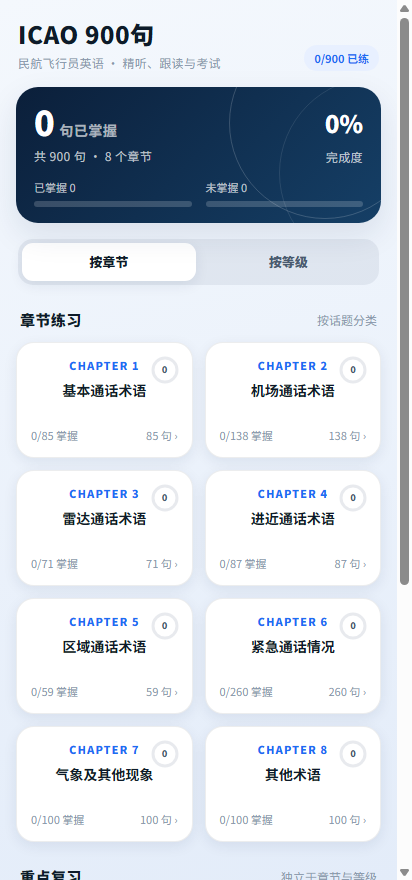
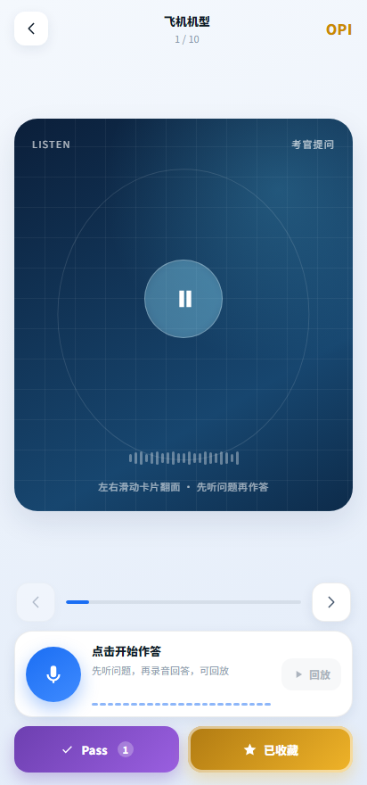
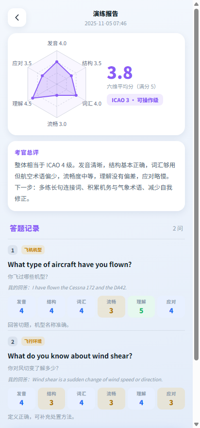
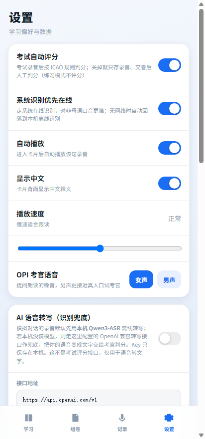

# ICAO 900 · OPI 口语练习

面向民航飞行员 / 空管的**离线优先**英语学习 Android 应用：900 句跟读练习 + PEPEC OPI 口语面试演练 + AI 考官模拟对话。

<p>
  
  
  
  
</p>

## 功能

**900 句练习**
- 按 ICAO 发音规则逐词评分（数字逐位读、连字符、缩写、runners/niner 同化等）
- 3D 翻面卡片：正面语音 + 波形，背面英文 / 中文 / 发音要点
- 已掌握 / 未掌握标记、章节进度记忆、组卷考试（3 级组 / 4 级组，录音存档 + 人工改判）

**OPI 口语面试（PEPEC）**
- 6 大类 / 69 话题 / 352 问，卡片式练习，考官提问语音（女声 / 男声可切换）
- Pass 计数与收藏夹（独立于 900 句进度）
- **模拟对话**：AI 扮演考官，随机抽 3~4 个话题、≤15 问，逐题六维评分（发音 / 结构 / 词汇 / 流畅 / 理解 / 应对）
- 结束给出**具体 ICAO 等级**（如 ICAO 3 次工作级、ICAO 4 工作级）、六维雷达图、文字总评与逐题记录

**语音识别（两种通道）**
- 本地 **Qwen3-ASR-0.6B**（llama.cpp 推理，完全离线，首次使用在应用内下载约 1 GB 模型）
- 可选 OpenAI 兼容的云端转写接口作为兜底（Key 只存本机）
- 模拟对话需要一种识别通道 + 一个 OpenAI 兼容对话模型（用于提问与评分）

## 下载安装

到 [Releases](../../releases) 下载最新 `ICAO900-OPI.apk`：
- Android 7.0+（minSdk 24），仅 **arm64-v8a**
- 侧载安装，无需 root；本应用不联网也能完成 900 句练习，仅模拟对话 / 云端转写 / 模型下载需要网络

## 从源码构建

无 Gradle，`build.sh` 手写调用 SDK 工具链（aapt2 → javac → d8 → 打包 dex + so → zipalign → apksigner）。

依赖：
- JDK 17（`javac` / `jar` / `java`）
- Android SDK build-tools（`aapt2`、`d8.jar`、`zipalign`、`apksigner.jar`）与 `android.jar`（API 34）
- Python 3（仅打包步骤里合并 dex 与 native 库时用到）

```bash
# 指向你自己的 SDK 缓存目录（需包含 sdk_bt / sdk_jdk / sdk_plat 三个子目录）
export ICAO_SDK_CACHE=/path/to/sdk-cache
bash build.sh
# 产物：dist/ICAO900-OPI.apk
```

> 若没有现成的 `ICAO_SDK_CACHE` 结构，可直接改 `build.sh` 顶部的 `JDK` / `BT` / `PLATFORM` 三行指向本机 SDK 路径。

## 项目结构

```
app/
  assets/            前端（HTML/CSS/JS 单页应用）+ 900 句数据与音频 + OPI 题库与 TTS
  java/com/icao/opi/ MainActivity（WebView 外壳）、TurnController（录音）、
                     LocalAsr（离线识别）、AiClient（云端转写）、ChatClient（对话模型）
  res/               图标与主题
libs/                llama.cpp / ggml / mtmd 的 arm64-v8a 预编译库
tools/               PDF 题库解析、中文翻译补全、OPI 组装与 TTS 生成、本地预览与自测
preview/            前端自测页（selftest / opitest / chattest）与截图页，不进 APK
build.sh            构建脚本
```

## 数据与素材说明

- **900 句题库与真人录音**：整理自公开的民航英语学习资料（内容源自 ICAO Doc 9835 附件常用语句），本项目仅做整理与离线打包。
- **OPI 题库**：由 `tools/parse_opi.py` 从网络公开流传的 PEPEC OPI 面试资料整理为结构化 JSON，并补全中文翻译。
- **考官提问语音**：由本项目用 Microsoft edge-tts 自行合成（`en-US-AriaNeural` 女声 / `en-US-GuyNeural` 男声），非任何第三方音频。
- **本地识别模型**：Qwen3-ASR-0.6B（通义千问开源，Apache-2.0），以 llama.cpp 在设备端推理。

## 免责声明

本项目为个人学习交流用途，**非官方、非商业化**，与 ICAO、CAAC 及任何培训机构无关。
题库与音频资料的版权归各自权利人所有，本项目仅为学习目的整理；如有侵权，请联系删除。
考试评级与评分仅为练习参考，不代表任何官方成绩。

## License

[MIT](LICENSE) © 2026 DQ-HollyLee
